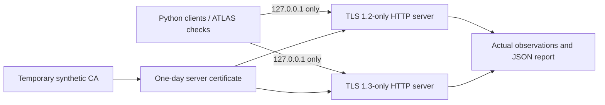

# Local TCP, TLS and HTTP verification

This extension exercises the existing ATLAS toolkit against two real Python servers on **127.0.0.1**. The certificates, hostname and HTTP responses are synthetic. TCP connections, certificate verification, TLS negotiation and HTTP requests are actually executed. No VM, Docker, Azure service or external target is involved.

## Recorded result — 26 October 2026

- **29/29 integration checks passed**, including negative controls and cleanup. [Machine-readable evidence](evidence/loopback-20261026.json).
- **11/11 pytest regression tests passed**: the original five tests plus six TLS tests. These are mostly mocked unit tests, separate from the live loopback checks. [JUnit-derived summary](evidence/pytest-20261026.json).
- Recorded environment: Windows, Python 3.14.7, Python/OpenSSL CLI 3.5.7. The integration report records UTC timestamps, negotiated certificates/ciphers, source hashes, server observations and expected handshake errors.

This is an extension of the existing NetOps project. It is not a new cloud deployment or evidence of the portfolio owner's independent proficiency.

## Test design



| Control | Expected and observed result |
|---|---|
| TCP connectivity | Each owned loopback port accepts a connection |
| Unknown private CA | Default trust rejects the server certificate |
| Explicit CA and matching name | TLS succeeds and returns the expected certificate SAN |
| Explicit CA and wrong name | Certificate verification rejects the name |
| Protocol negotiation | Each server negotiates its configured TLS version |
| TLS 1.2 client against TLS 1.3-only server | Protocol-version alert, not a certificate failure |
| `/health` and `/missing` | Actual HTTP 200 and 404 with fixed JSON bodies, observed on client and server |
| Cleanup | Threads stopped, socket handles closed, connections refused and temporary certificate/key directory removed |

The Python API `check_https(host, port=443, timeout=5, *, cafile=None, server_hostname=None)` now accepts a private CA bundle and an optional certificate name/SNI independently of the destination IP. Default certificate and hostname verification remain enabled. These are Python API options; the existing CLI arguments are unchanged. Failures include `error_type` for diagnosis.

Python's [SSL context documentation](https://docs.python.org/3.14/library/ssl.html#ssl.create_default_context) describes verified client contexts and custom trust bundles. The name `atlas-loopback.invalid` is used only for certificate verification/SNI; the code connects directly to 127.0.0.1 and does not request DNS resolution of that name.

## Reproduce

Use an existing Python 3.11+ runtime with TLS 1.3 support and an existing OpenSSL 3 executable. The integration runner itself uses only the Python standard library and the repository source. The recorded run used Python 3.14.7; other supported versions have not been locally verified.

From the repository root:

```bash
python labs/loopback-tls/run_lab.py --openssl /path/to/openssl
```

On Windows with an existing Git for Windows OpenSSL installation:

```powershell
python labs/loopback-tls/run_lab.py --openssl 'C:\Program Files\Git\mingw64\bin\openssl.exe'
```

The program allocates ephemeral ports, writes a new report under `reports/`, exits nonzero on a failed check, and removes its own temporary keys/certificates in normal and handled-error paths. No certificate is added to the OS trust store. The runner refuses to start if `SSLKEYLOGFILE` is set, to avoid writing session keys elsewhere. Hard termination or power loss can interrupt cleanup: after confirming that the lab process has exited, inspect only this lab's `reports/atlas-tls-*` directories for leftovers. Do not publish keys or use these one-day test certificates elsewhere.

Run regression tests in an isolated Python environment using the repository's existing requirements:

```bash
python -m pip install -r requirements.txt
python -m pip install -e .
python -m pytest -q tests
```

The recorded Windows regression run used a project-local `.test-deps/` directory instead of a global install. Dependencies and repeat-run reports are excluded from Git. The original CI workflow also collects the six new unit tests; the live loopback runner remains an explicit local command.

## Troubleshooting and evidence limits

The first execution on 26 October was blocked by sandbox socket permissions (`WinError 10013`). It was **not** a successful TLS test. A permitted rerun reached the local services. Review also tightened the cleanup assertion so a permission error cannot count as proof that a listener closed. Windows may reset a TLS inspection connection when it closes before sending HTTP; the runner records such probe resets separately and fails on other handler errors. The final 29-check report corresponds to the published source hashes.

Expected handshake errors appear in the evidence: a TCP-only probe closes before TLS, an untrusted CA and wrong hostname are rejected, and the protocol mismatch is rejected. OpenSSL reason names containing `SSLV3` are error identifiers, not evidence that SSLv3 was negotiated. See the separately recorded `tls_version` values.

No packet capture, PCAP, Wireshark, pfSense, VLAN, routing, firewall segmentation, DNS server or production PKI was tested. The server records application observations, not network-capture evidence. Python's [HTTP server documentation](https://docs.python.org/3.14/library/http.server.html) cautions against using this server for production; this runner exposes only fixed test responses on loopback for a few seconds.

Certificates, fingerprints, serial numbers, ports and timestamps change on each run. Compare assertions and source hashes, not byte-for-byte report equality. The JSON report is a reproducible lab record, not externally signed attestation.
